# Agentic SDLC workshop: GitHub Copilot, GHEC, Azure AKS, and Argo CD

Build a traceable, human-governed delivery loop from a GitHub issue to a running
application on Azure Kubernetes Service (AKS). GitHub Copilot proposes code,
GitHub Actions checks and packages it, and Argo CD reconciles the approved
deployment configuration.

**Audience:** developers, platform engineers, and technical leads with a GitHub
Copilot account and an Azure subscription. No existing AKS cluster is required.
Use a disposable development environment, not a production subscription.

**Format:** instructor-led, step-by-step labs; allow 3-4 hours plus administrator
setup. Azure provisioning and enterprise approvals can take longer. Azure
resources, ACR builds, GitHub Actions, and Copilot usage may incur charges.

## Learning outcomes

By the end, you can turn acceptance criteria into an agent task, review an
agent-authored PR, authenticate CI to Azure without a client secret, publish an
image by digest, promote it through a GitOps PR, and verify or roll back a release
with an evidence trail.

## Delivery path

```mermaid
flowchart LR
    I[GitHub issue and acceptance criteria] --> C[Copilot implementation]
    C --> P[Application PR]
    P --> T[GitHub Actions checks]
    T --> H[Human review and merge]
    H --> B[Actions builds image in ACR]
    B --> R[Release PR updates image digest]
    R --> A[Human approval and merge]
    A --> G[Argo CD reads Git]
    G --> K[AKS workload]
    K --> E[Verification and issue evidence]
```

GitHub Actions has **no AKS credentials** and does not run `kubectl apply` against
the cluster. The Azure federated identity can build images in one registry; the
AKS kubelet can pull them; Argo CD has read-only access to Git. A GitHub App opens
release PRs with a short-lived installation token.

## Lab sequence

| Lab | Time | Guide | Checkpoint |
| --- | --- | --- | --- |
| 0 | 30 min | [Prerequisites and enterprise setup](docs/00-prerequisites.md) | Repository, policies, tools, and app tokens ready |
| 1 | 35 min | [Provision Azure and OIDC](docs/01-azure-foundation.md) | AKS, ACR, and federated CI identity ready |
| 2 | 25 min | [Bootstrap Argo CD](docs/02-argocd.md) | Controller can read the private repository |
| 3 | 40 min | [Issue to Copilot pull request](docs/03-issue-to-pr.md) | Reviewed feature PR with passing tests |
| 4 | 30 min | [CI, image build, and GitOps release](docs/04-ci-and-release.md) | Approved digest reaches Git |
| 5 | 25 min | [Verify, operate, and roll back](docs/05-verify-and-rollback.md) | Running feature and completed evidence chain |
| 6 | 10 min | [Cleanup and production discussion](docs/06-cleanup.md) | Workshop resources and access removed |

Use [troubleshooting](docs/troubleshooting.md) when a checkpoint fails.
Facilitators can use the [instructor notes](docs/instructor-notes.md).

## What's included

- A dependency-free Python HTTP app and unit/HTTP tests in `app`.
- A non-root `Dockerfile`, Kubernetes probes, resource limits, and a ClusterIP
  service in `deploy`.
- An issue form and repository-level Copilot instructions in `.github`.
- PR checks and an OIDC image-build/release-PR workflow in `.github/workflows`.
- An Argo CD project and application template in `argocd`.

The initial app has `/`, `/healthz`, and `/version`. Participants ask Copilot to
add `/api/greeting`; that feature is intentionally **not implemented** in the
starter. Deployment templates deliberately use an invalid image until the first
release PR replaces it. Azure image publication is disabled by default; Lab 4
explicitly opts in after configuring the required identities and settings.

## Scope and safety

This is an Agentic SDLC pattern, not an installation of GitHub Agentic Workflows.
Issue assignment starts the agent after human triage; creating an arbitrary issue
does not automatically grant an agent deployment privileges. Do not put secrets,
customer data, or production access in an issue, prompt, repository, or agent
environment.

The baseline targets GHEC on `github.com`, Linux GitHub-hosted runners, and
PowerShell 7 for learner commands. GHEC with data residency, private networking,
or restricted enterprise runners needs administrator-specific adaptations.
This workshop uses a fixed-size AKS Standard cluster with the Free control-plane
tier for transparent lab compute and networking choices; it is not a production
architecture or an AKS Automatic sizing recommendation.

See the linked official references in each lab before running commands; cloud
agent names, UI labels, supported regions, and action versions evolve.